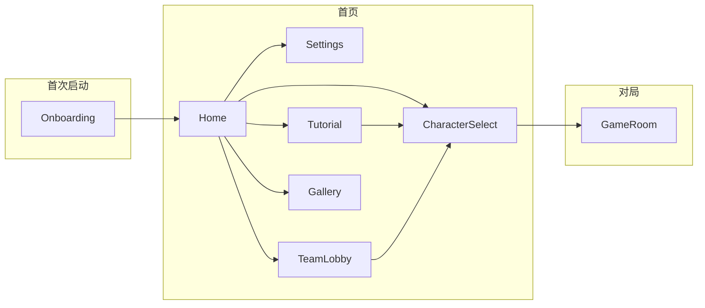

# AI Werewolf（AI 狼人杀）产品需求文档（PRD）

| 项目 | 说明 |
|------|------|
| **文档版本** | v1.0 |
| **产品形态** | React Native（Expo）移动端应用，强制横屏 |
| **现状摘要** | 单人 + AI 陪练局、新手教学、角色图鉴、演示级组队开局；局内规则引擎与 AI 发言（远程 LLM 可选，无 Key 时本地兜底） |

---

## 1. 背景与机会

### 1.1 问题陈述

- 线下/线上凑齐 **12 人标准狼人杀** 成本高，新手学习曲线陡。
- 玩家需要 **随时可开一局**、**可反复练习** 且 **对手行为相对稳定可预期** 的环境。

### 1.2 产品机会

用 **11 名具备固定人设与难度分层的 AI 玩家** 补足牌桌，真人以 **1 人** 身份入局，在完整昼夜流程中练习发言、听感与身份博弈；可选 **大模型增强发言真实感**，无网络密钥时仍可用 **本地规则化发言** 保证可玩性。

---

## 2. 产品愿景与目标

### 2.1 愿景

**「天黑请闭眼，AI 就位——无需凑人也能打满一局标准板子。」**

### 2.2 目标（可度量方向）

| 维度 | 目标 |
|------|------|
| **可用性** | 用户从首页到进入首局 **路径清晰**，核心文案中/英一致 |
| **学习** | 新手可在 **教学链路** 内完成选板、理解基础规则并进入练习 |
| **沉浸** | 讨论环节 AI 发言 **引用日志、回应真人**，避免「首置位编造」 |
| **扩展** | 板型、难度、角色池 **可配置**，便于后续加板子/赛季 |

---

## 3. 目标用户与场景

### 3.1 核心用户

| 用户 | 需求 |
|------|------|
| **休闲练习玩家** | 碎片时间单排，不想社交组局 |
| **规则 learner** | 需要 **教学 + 慢节奏** 理解技能与流程 |
| **进阶玩家** | 希望通过 **难度与板型** 拉长对局深度 |

### 3.2 关键场景

1. **单人对局**：选板型 → 选难度 → 选 11 名 AI → 发牌入局。
2. **新手教学**：引导选板 →（可选）进入设置 → 按步骤教学 → 进入练习选人（常锁定新手难度）。
3. **角色图鉴**：仅浏览 **48 人设**，不入局。
4. **演示联机**：组队开局—邀请好友或输入房间号（**当前为演示流程**，非完整实时联机后端）。

---

## 4. 范围界定

### 4.1 本期包含（In Scope）

- 首次启动 **引导页（Onboarding）**，写入本地「已启动」标记。
- **首页**：单人、**组队开局**、新手教学、角色图鉴、**个人设置（齿轮入口）**。
- **设置**：界面语言（中/英）、昵称（局内显示为「我」）、Q 版头像（6 款）。
- **选角页**：按难度筛选 AI 池；选满 **11** 名 AI；随机选人；板型 **标准 12 人（预女猎白）** / **狼美人·守卫**；支持从教程/建房/加房带参数锁定。
- **游戏房间**：完整 **阶段机**（初始化、夜间狼刀、狼美人魅惑、预言家、女巫、公布死讯、警长竞选/发言、投票等）；**AI 讨论发言**（远程 API 可用时使用配置的大模型；否则本地生成）；教学局可选 **遗言规则提示** 等。
- **国际化**：关键界面 **中文 / English**。
- **体验**：**横屏锁定**；宽屏首页 **双栏布局**，窄屏 **纵向卡片**。

### 4.2 本期不包含或仅为演示（Out of Scope / Demo）

- **真实实时多人同步服务器**（房间代码、邀请、准备流程为 **产品流程演示**，非商用联机基础设施）。
- **账号体系、付费、匹配大厅**。
- **全角色平衡性竞技排位**（当前以练习与内容体验为主）。

---

## 5. 用户旅程（高层）

---

## 6. 功能需求（按模块）

### 6.1 全局与导航

| ID | 需求 | 优先级 |
|----|------|--------|
| G-01 | App 启动后 **锁定横屏**；回到前台时重新锁定 | P0 |
| G-02 | 首次启动 **Onboarding**，否则 **Home** | P0 |
| G-03 | 全局 **无系统 Header**，各屏自建标题/返回 | P0 |

### 6.2 首页

| ID | 需求 | 优先级 |
|----|------|--------|
| H-01 | 展示品牌区（Logo、副标题 **AI 陪练 · 随时开局**） | P0 |
| H-02 | 入口：**单人对局**、**组队开局**、**新手教学**、**角色图鉴** | P0 |
| H-03 | 右上角 **齿轮图标** 进入设置；无障碍读出「个人设置/Profile」 | P0 |
| H-04 | 宽屏 **双栏 + 卡片网格**；窄屏 **纵向堆叠** | P1 |

### 6.3 个人设置

| ID | 需求 | 优先级 |
|----|------|--------|
| S-01 | **界面语言**：中文 / English，持久化 | P0 |
| S-02 | **昵称**：最多 16 字，局内用于「我」的展示；可清空恢复默认 | P0 |
| S-03 | **头像**：6 款 Q 版肖像选一，持久化 | P0 |
| S-04 | 保存后返回上一页 | P0 |

### 6.4 新手教学

| ID | 需求 | 优先级 |
|----|------|--------|
| T-01 | 按步骤推进（语言/选板等依现有 tutorial 步骤配置） | P0 |
| T-02 | **选版（pickBoard）阶段** 顶部提供 **齿轮入口**，进入 **Settings**，与首页一致资源 | P0 |
| T-03 | 结束后跳转 **选角**，可 **锁定新手难度** / 板型等（与路由参数一致） | P0 |

### 6.5 选角（Character Select）

| ID | 需求 | 优先级 |
|----|------|--------|
| C-01 | 从 AI 池中 **选择 11 名** 角色；可 **随机** | P0 |
| C-02 | **难度**：Novice / Easy / Medium / Hard；筛选当前难度池（图鉴模式仅浏览） | P0 |
| C-03 | **板型**：Standard12 / WolfBeauty（可被教程或建房流程锁定） | P0 |
| C-04 | 展示角色 **人设、星座、描述** 等（与数据一致） | P1 |
| C-05 | **48 固定人格**（与文案「48 位固定人格」一致） | P0 |

### 6.6 组队开局（演示）

| ID | 需求 | 优先级 |
|----|------|--------|
| R-01 | **邀请好友**：展示 **6 位房间号**、邀请与准备 **演示流程**；同页 **本局设置**：难度与板型 | P1 |
| R-02 | **输入房间号**：输入 **6 位数字**，校验通过后进入 **选 AI** | P1 |
| R-03 | 说明文案标明 **演示联机**，管理用户预期 | P0 |

### 6.7 游戏房间（核心局内）

| ID | 需求 | 优先级 |
|----|------|--------|
| GR-01 | 支持板型对应的 **夜间顺序**（含狼美人局额外阶段） | P0 |
| GR-02 | **昼夜切换**、死亡结算、日志时间线 | P0 |
| GR-03 | **讨论环节**：AI 发言需结合 **最近日志**；**首置位** 禁止编造他人具体行为；需 **回应真人玩家** 的近期观点 | P0 |
| GR-04 | **难度** 影响发言激进程度与逻辑深度（Novice 短句少带队，Hard 更犀利） | P1 |
| GR-05 | **远程 LLM**：环境变量配置 API Key；无效或未配置时 **自动降级本地发言** | P0 |
| GR-06 | 教学入局：首夜有人出局等时机可触发 **遗言规则说明**（`fromTutorial`） | P1 |

---

## 7. 非功能需求（NFR）

| 类别 | 要求 |
|------|------|
| **性能** | 局内滚动与阶段切换流畅；AI 请求失败不阻断回合推进（应有超时与兜底）。 |
| **可靠性** | 本地 AsyncStorage 读写失败不应白屏；首次启动检测异常时 **降级为非首次**。 |
| **隐私** | 昵称、头像、语言 **仅存本地**；API Key **不显式写入客户端仓库**（环境变量）。 |
| **可维护性** | 文案集中 **i18n**；游戏阶段与角色类型 **TypeScript 类型约束**。 |
| **无障碍** | 关键按钮（如设置齿轮）提供 **accessibilityLabel**。 |

---

## 8. 内容与文案策略

- **中/英** 并行；首页 Footer 强化心智：**「天黑请闭眼，AI就位，无需他人」**。
- **组队开局** 明确标注 **演示**，避免用户误以为已支持全真联机。
- AI 提示词侧：**禁止元词汇、禁止死后在非遗言环节发言** 等与实现对齐。

---

## 9. 指标建议（上线后可埋点）

| 指标 | 说明 |
|------|------|
| **激活到首局完成率** | Onboarding → GameRoom 至少完成一局 |
| **教学模式完成率** | Tutorial 完成人数 |
| **难度 / 板型分布** | 各选项占比 |
| **AI 发言路径比** | Remote vs Local 成功占比（若可观测） |
| **会话时长与局数** | 粘性 |

（埋点为建议项，依实际上线策略接入。）

---

## 10. 依赖与风险

| 风险 | 缓解 |
|------|------|
| **LLM 不可用或限流** | 已实现本地发言兜底 |
| **演示联机与用户预期不符** | UI 持续标明「演示」；长期需 **真实房间服务** |
| **横屏与设备差异** | 持续适配安全区与折叠屏 |
| **平衡性与作弊感** | 持续调 prompt、难度与日志引用策略 |

---

## 11. 路线图建议（产品视角）

| 阶段 | 方向 |
|------|------|
| **短期** | 稳定单人体验、教学闭环、图鉴与文案统一 |
| **中期** | 真实房间服务、好友邀请、观战或回放 |
| **长期** | 赛季、更多板型、语音合成、社区人设包 |

---

## 12. 开放问题（待产品决策）

1. 演示联机是否在 **1.0 对外包** 中隐藏或二级入口，以降低客服解释成本？
2. **默认语言** 是否跟随系统 locale，还是维持当前「存储优先」策略？
3. **商业化**（若有）：人设皮肤、高级 AI、增值权益等是否纳入路线图？

---

## 变更记录

| 版本 | 日期 | 说明 |
|------|------|------|
| v1.0 | 2026-05-08 | 初版入库，与当前代码能力对齐 |
